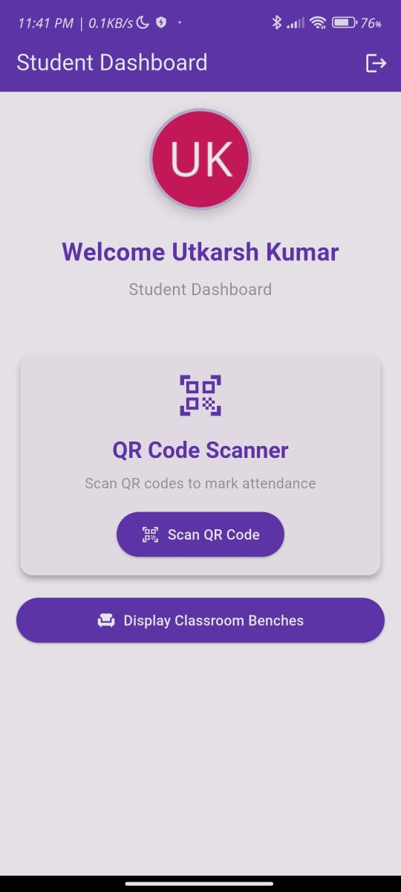
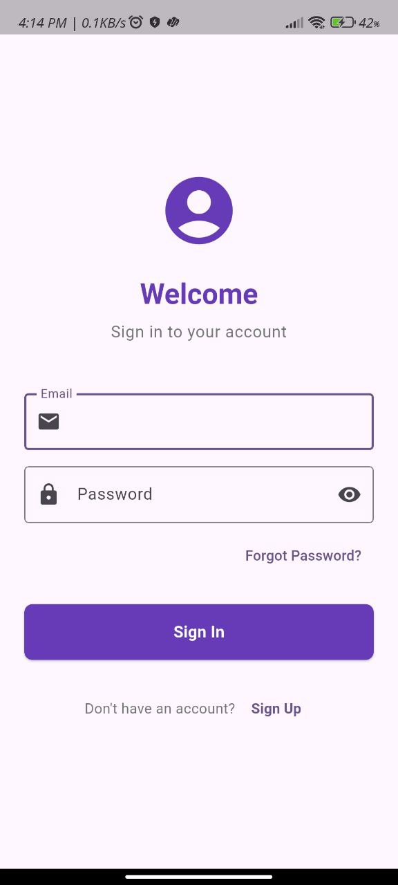

# 🎯 Benchmark - Smart Attendance Management System

[](https://flutter.dev)
[](https://dart.dev)
[](LICENSE)

A cutting-edge, secure attendance management system that revolutionizes classroom attendance tracking through QR code technology and advanced security features.

## 📱 Screenshots

<div align="center">
  
  
</div>

## ✨ Key Features

### 🔐 Advanced Security
- **Clone Detection**: Prevents attendance marking from cloned/emulated devices
- **GPS Spoofing Protection**: Validates authentic location data
- **Location Verification**: Ensures students are physically present in the classroom
- **Device Authentication**: Multi-layer device validation system
- **Secure Data Transmission**: End-to-end encrypted communication

### 📍 Smart Attendance System
- **QR Code Scanning**: Fast and accurate QR code recognition
- **Real-time Validation**: Instant attendance verification
- **Geofencing**: Location-based attendance constraints
- **Time-window Control**: Configurable attendance time limits
- **Offline Capability**: Works without internet connection

### 👥 User Management
- **Student Dashboard**: Personal attendance records and statistics
- **Instructor Panel**: Class management and QR generation tools
- **Admin Interface**: System-wide attendance monitoring
- **Multi-role Support**: Different access levels for various user types

### 🎨 Modern UI/UX
- **Material Design 3**: Beautiful, intuitive interface
- **Dark/Light Theme**: Customizable appearance
- **Responsive Design**: Works seamlessly across all screen sizes
- **Accessibility**: WCAG compliant for inclusive usage

## 🚀 How It Works

1. **Instructor Setup**: Teacher generates a unique QR code for their class
2. **Student Scan**: Students scan the QR code using the mobile app
3. **Security Validation**: System verifies device authenticity and location
4. **Attendance Marked**: Successful validation records the attendance
5. **Real-time Updates**: Attendance data syncs across all platforms

## 🛠️ Technical Stack

- **Frontend**: Flutter (Dart)
- **Backend**: Node.js/Express (or your backend choice)
- **Database**: Mongodb
- **Authentication**: JWT + OAuth
- **Security**: Custom device fingerprinting
- **Location Services**: GPS + Network triangulation
- **QR Processing**: Qr scanner package

## 📋 Prerequisites

Before you begin, ensure you have the following installed:

- [Flutter SDK](https://flutter.dev/docs/get-started/install) (>=3.0.0)
- [Dart SDK](https://dart.dev/get-dart) (>=2.17.0)
- [Android Studio](https://developer.android.com/studio) or [VS Code](https://code.visualstudio.com/)
- [Git](https://git-scm.com/)

## 🔧 Installation & Setup

### 1. Clone the Repository
```bash
git clone https://github.com/utkarshkgithub/Benchmark.git
cd Benchmark
```

### 2. Install Dependencies
```bash
flutter pub get
```

### 3. Environment Configuration
Create a `.env` file in the root directory:
```env
BACKEND_URL=your_backend_url_here
API_KEY=your_api_key_here
ENCRYPTION_KEY=your_encryption_key_here
```

### 4. Platform Setup

#### Android
```bash
cd android
./gradlew clean
cd ..
```

#### iOS
```bash
cd ios
pod install
cd ..
```

### 5. Run the Application
```bash
# Debug mode
flutter run

# Release mode
flutter run --release

# Specific platform
flutter run -d android
flutter run -d ios
```

## 📱 Building for Production

### Android APK
```bash
flutter build apk --release
```

### Android App Bundle
```bash
flutter build appbundle --release
```

### iOS
```bash
flutter build ios --release
```

<!-- ## 🧪 Testing

Run the complete test suite:
```bash
# Unit tests
flutter test

# Integration tests
flutter test integration_test/

# Code coverage
flutter test --coverage
``` -->

## 📊 Project Structure

```
lib/
├── main.dart                     # Application entry point
├── models/                       # Data models
├── providers/                    # State management
├── screens/                      # UI screens
│   ├── attendance_screen.dart    # Attendance tracking interface
│   ├── change_password_screen.dart # Password management
│   ├── classroom_benches.dart    # Classroom seating management
│   ├── forgot_password_screen.dart # Password recovery
│   ├── home_screen.dart          # Main dashboard
│   ├── instructor_screen.dart    # Teacher interface
│   ├── login_screen.dart         # User authentication
│   ├── qr_scanner_screen.dart    # QR code scanning with security
│   ├── signup_screen.dart        # User registration
│   └── splash_screen.dart        # App loading screen
├── services/                     # Business logic & APIs
├── utils/                        # Utilities & helpers
└── widgets/                      # Reusable UI components
```

## 🔒 Security Features

- **Anti-Spoofing**: Advanced algorithms detect location manipulation
- **Device Fingerprinting**: Unique device identification prevents fraud
- **Behavioral Analysis**: ML-based suspicious activity detection
- **Secure Storage**: Encrypted local data storage
- **Network Security**: TLS/SSL encryption for all communications

## 🤝 Contributing

We welcome contributions! Please see our [Contributing Guide](CONTRIBUTING.md) for details.

1. Fork the repository
2. Create your feature branch (`git checkout -b feature/AmazingFeature`)
3. Commit your changes (`git commit -m 'Add some AmazingFeature'`)
4. Push to the branch (`git push origin feature/AmazingFeature`)
5. Open a Pull Request

<!-- ## 📄 API Documentation

Detailed API documentation is available at [API Docs](API.md) or visit our [Postman Collection](https://postman.com/your-collection). -->

## 🐛 Issue Reporting

Found a bug? Please report it [here](https://github.com/utkarshkgithub/Benchmark/issues) with:
- Device information
- Steps to reproduce
- Expected vs actual behavior
- Screenshots/logs if applicable

## 📈 Roadmap

- [ ] **v2.0**: Facial recognition integration
- [ ] **v2.1**: Voice-based attendance
- [ ] **v2.2**: AI-powered analytics dashboard
- [ ] **v2.3**: Multi-language support


## 📞 Support & Contact

- **Developer**: [@utkarshkgithub](https://github.com/utkarshkgithub)

## 📜 License

This project is licensed under the MIT License - see the [LICENSE](LICENSE) file for details.

<div align="center">
  <strong>Made with ❤️ for the future of education</strong>
  <br>
  <sub>Star ⭐ this repository if you found it helpful!</sub>
</div>